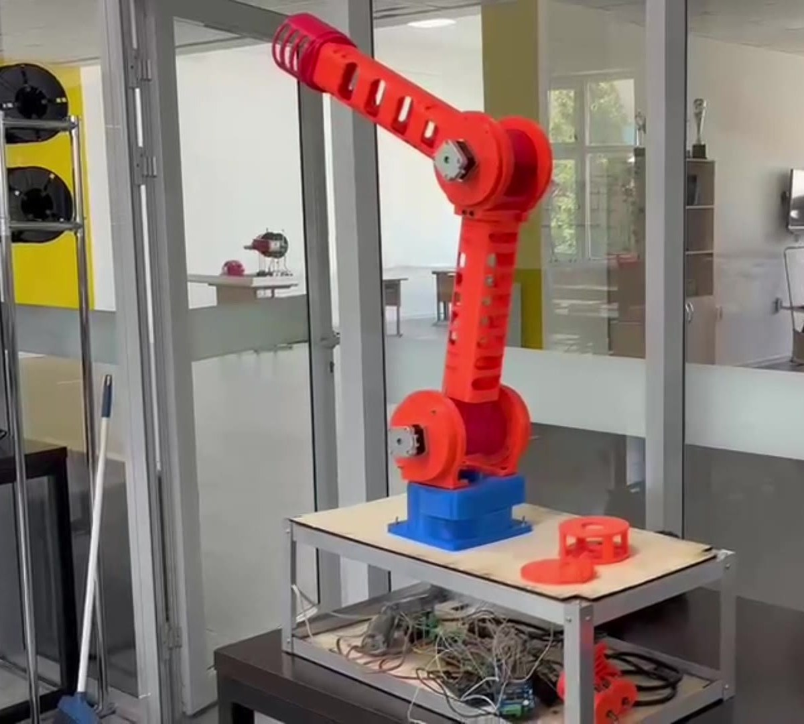
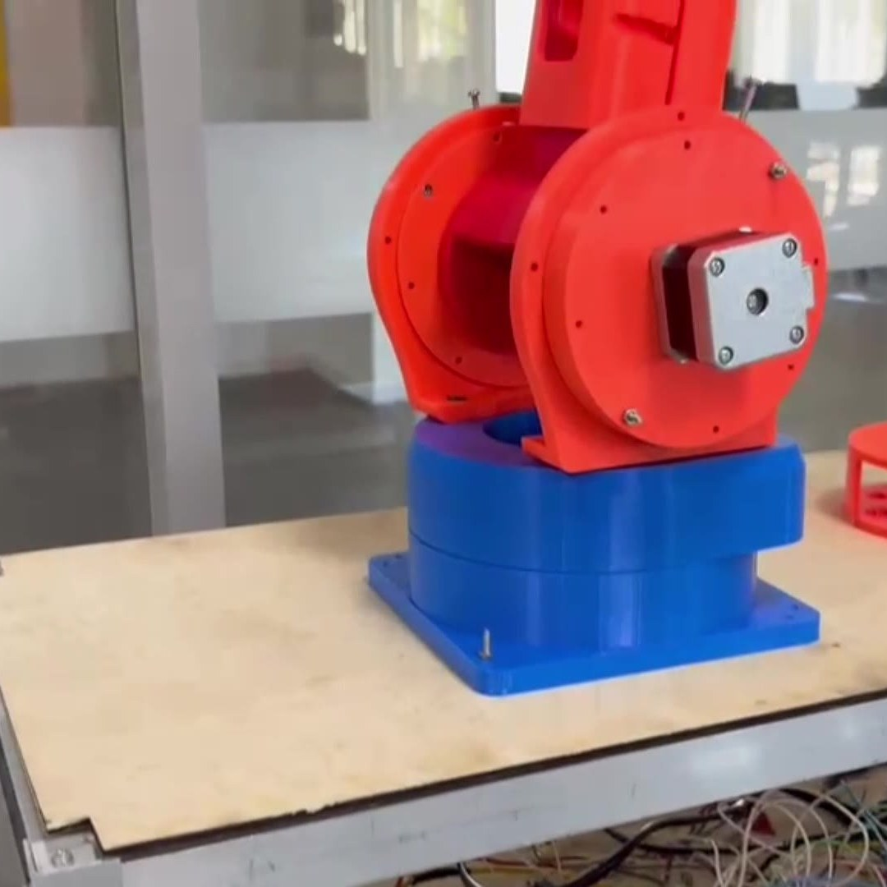
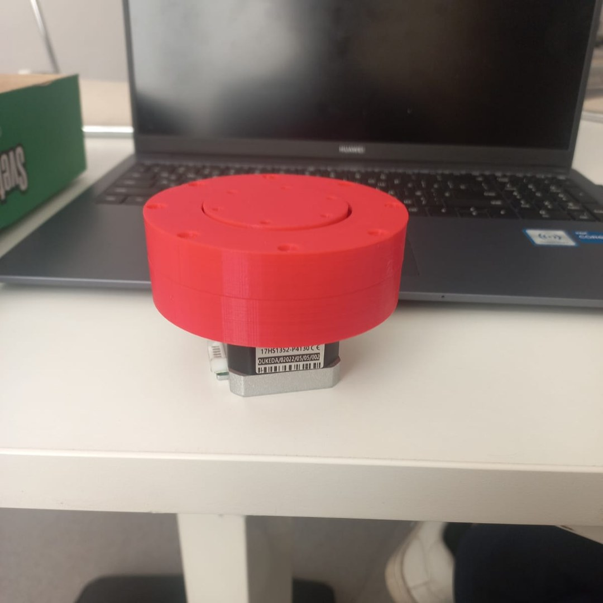
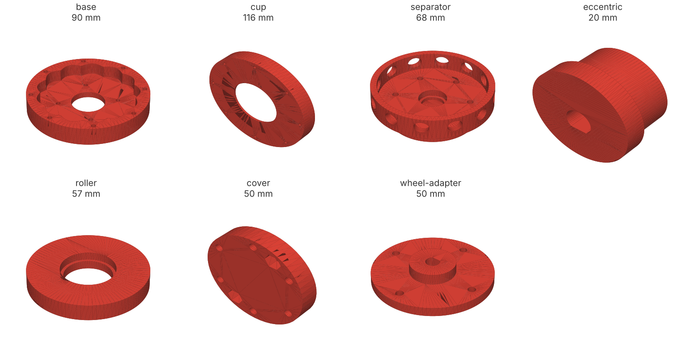
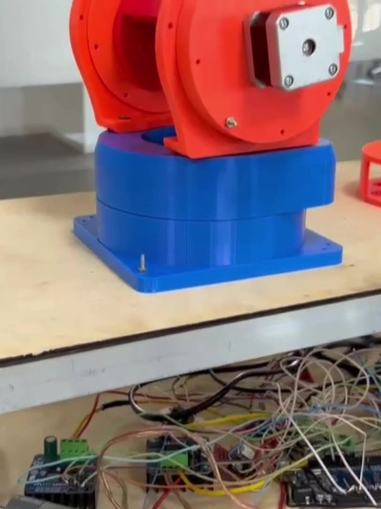
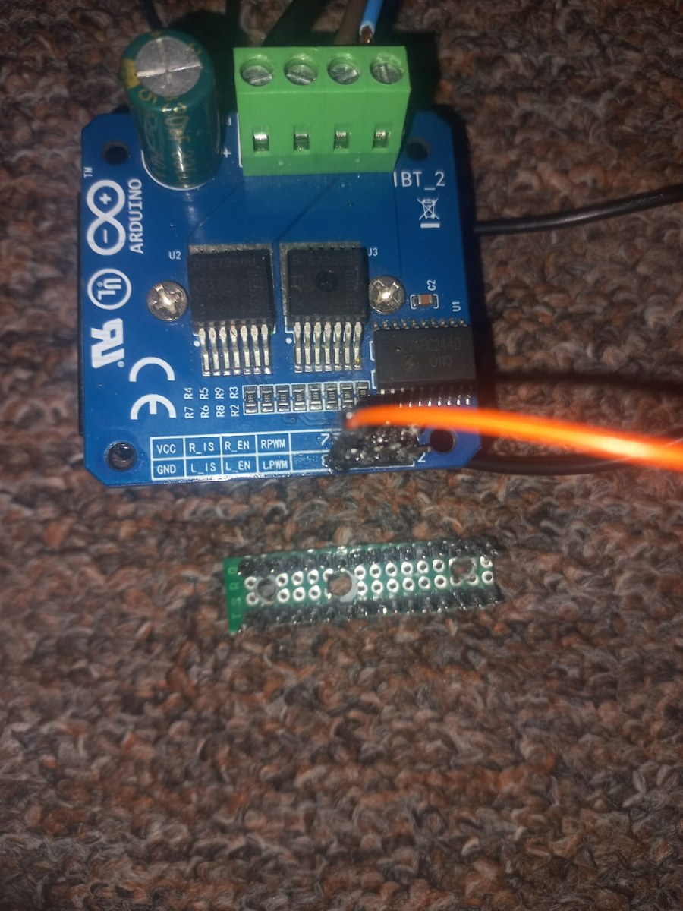
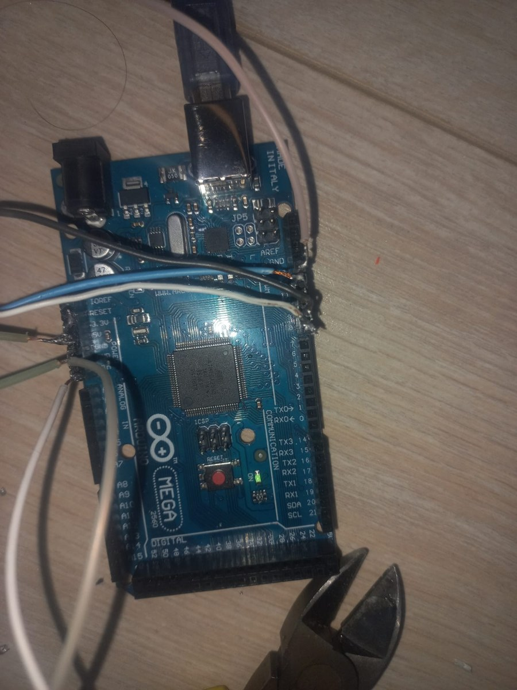

# RoboRestorer

A 3D-printed robot arm for restoring marble statues.
Team Tartarus, WRO 2026, 3rd place in the regional round. Unfinished prototype.

&nbsp;

Marble statues crack and wear down from rain, frost, dust and accidents. Restoring them by hand is slow, expensive and needs rare specialists.

Our idea was an arm that scans the surface, finds cracks, cleans the area, fills the cracks with glue drop by drop and then smooths the surface. We built the arm and its drive electronics. The scanning and restoring tools were not finished before the competition.

&nbsp;

## Joints

A robot arm needs joints that are strong, compact and have almost no backlash. Ready-made gearboxes like that are expensive, so we printed our own.

Each joint uses a strain-wave reducer with rolling elements. A stepper motor turns an eccentric, the eccentric pushes the rollers through a separator, and the rollers run along a wavy track in the base. The output turns many times slower than the motor, with much more torque.

<table>
  <tr>
    <td width="50%"></td>
    <td width="50%"></td>
  </tr>
  <tr>
    <td align="center">The base joint</td>
    <td align="center">First printed reducer on a stepper motor</td>
  </tr>
</table>

The wavy profile was calculated with an open script, and I modelled the parts around it. The housing is 90 mm across. The models are in [`models/`](models):

&nbsp;

## Electronics

An Arduino Mega controls the motors through motor drivers, including a BTS7960. Everything is mounted on a shelf under the arm.

<table>
  <tr>
    <td width="33%"></td>
    <td width="33%"></td>
    <td width="33%"></td>
  </tr>
</table>

&nbsp;

## Status

The arm is assembled and its joints are driven by the printed reducers. The restoration tools, the crack scanning and the control software were not finished, so the robot has not worked on a real statue.

&nbsp;

---

Team Tartarus: Shakhnur Oralbek (team leader), Saltanat Tolegen, Akniet Moldakerimov 
My part: designed and 3D-printed the joint reducers, wired the electronics 
Supervisor: Nikolay Avdyunin, NIS Taldykorgan 
The reducer profile was calculated with the open script by [TrashRobotics](https://codeberg.org/TrashRobotics)
